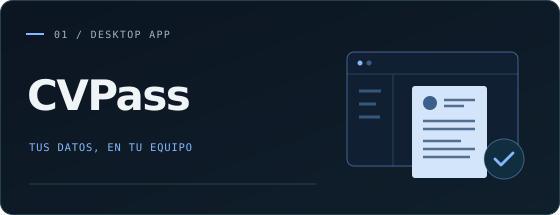
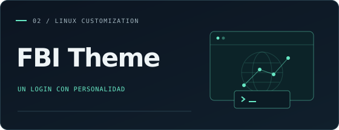
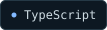
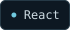
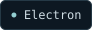
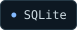
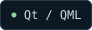
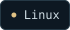
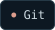

<picture>
  <source media="(prefers-reduced-motion: reduce)" srcset="assets/header-static.svg">
  
</picture>

## Construir. Entender. Proteger.

Soy **Alexandru**. Me gusta crear herramientas útiles, cuidar las interfaces y entender cómo funcionan los sistemas por dentro. Por aquí encontrarás desarrollo, Linux y mi interés por la **ciberseguridad**.

[Mis repositorios](https://github.com/alexandruraboaca00?tab=repositories) · [CVPass](https://github.com/alexandruraboaca00/cvpass) · [FBI Theme](https://github.com/alexandruraboaca00/FBI_theme_Login_GUI)

### Proyectos destacados

<table>
  <tr>
    <td width="50%" valign="top">
      
      <h4>CVPass</h4>
      
Un editor de currículums de escritorio: datos en local, funcionamiento offline y exportación a PDF.

      
TypeScript · React · Electron · SQLite

      <a href="https://github.com/alexandruraboaca00/cvpass">Explorar CVPass →</a>
    </td>
    <td width="50%" valign="top">
      
      <h4>FBI Theme</h4>
      
Una pantalla de acceso para Linux con estética CRT, mapa animado y detalles de terminal.

      
Qt 6 · QML · SDDM · KDE Plasma

      <a href="https://github.com/alexandruraboaca00/FBI_theme_Login_GUI">Explorar el tema →</a>
    </td>
  </tr>
</table>

<strong>Ver los proyectos por dentro</strong> · capturas y demostración

#### CVPass

#### FBI Theme Login GUI

### Mi caja de herramientas

  
  
  
  
  
  
  

### En el radar

- **Ciberseguridad:** entender cómo funcionan los sistemas y cómo protegerlos.
- **Linux:** personalizar el entorno y explorar lo que hay debajo de la interfaz.
- **Privacidad:** herramientas que permiten mantener los datos en tu equipo.

---

La curiosidad también se compila.

