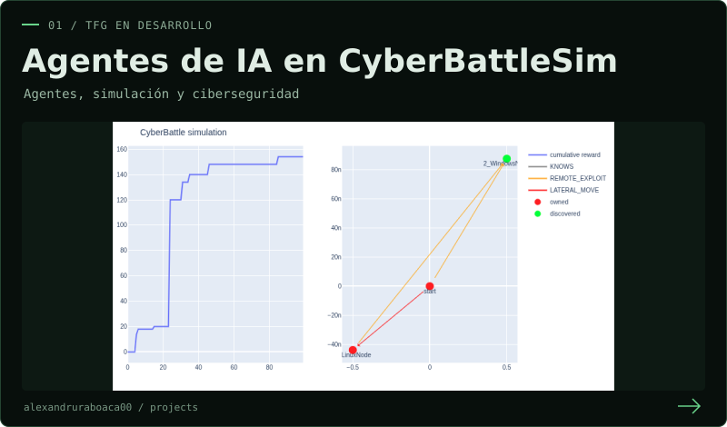
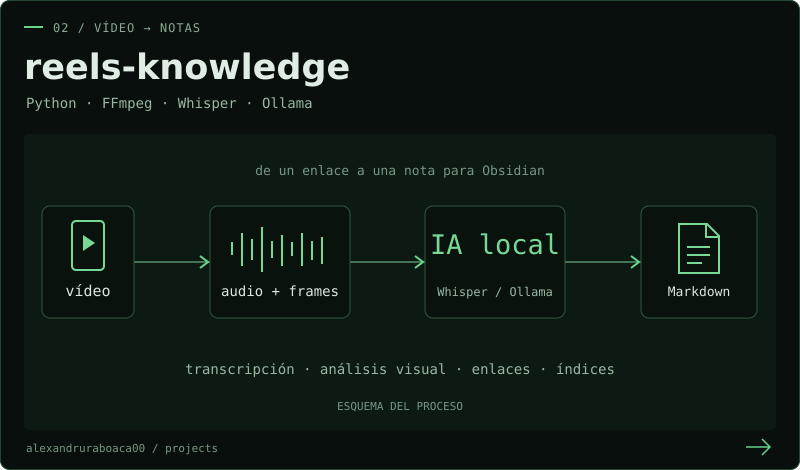
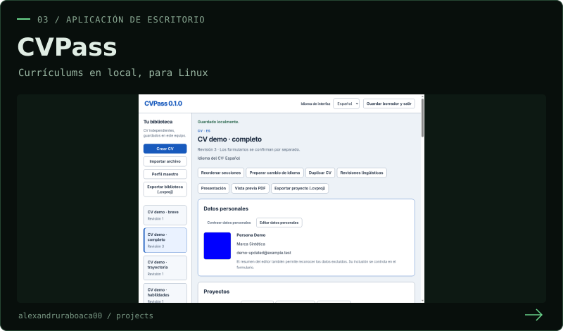
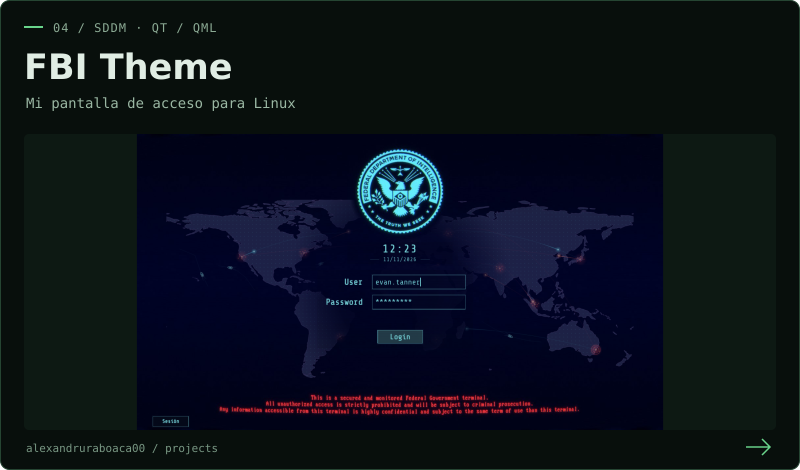

<picture>
  <source media="(prefers-reduced-motion: reduce)" srcset="assets/header-static.svg">
  
</picture>

## Buenas, soy Alexandru

Me gustan la **ciberseguridad**, Linux y hacer herramientas que me resulten útiles. Aquí están mis proyectos personales y mi TFG.

En algunos proyectos también programo con ayuda de **IA**. La uso para escribir parte del código, probar ideas y resolver problemas.

## Proyectos

<table>
<tr>
<td width="50%" valign="top">

<h3>TFG · CyberBattleSim</h3>

Mi TFG sobre agentes de IA en simulaciones de ciberseguridad: decisiones, comportamiento y evaluación.

En desarrollo; la imagen muestra una primera prueba real. Empezó en mi otra cuenta, Alrx666, y conserva el historial.

<a href="https://github.com/alexandruraboaca00/TFG-Agentes-IA-CyberBattleSim"><strong>Ver el TFG →</strong></a>

</td>
<td width="50%" valign="top">

<h3>reels-knowledge</h3>

Vídeos y reels a notas para <strong>Obsidian</strong>, con transcripción, fotogramas y enlaces. Modelos en local.

Me gusta poder sacar de un vídeo una nota que luego puedo consultar.

<a href="https://github.com/alexandruraboaca00/reels-knowledge"><strong>Ver reels-knowledge →</strong></a>

</td>
</tr>
<tr>
<td width="50%" valign="top">

<h3>CVPass</h3>

Editor de currículums para Linux. Guarda los datos en local, funciona offline y exporta a PDF.

TypeScript · React · Electron · SQLite

<a href="https://github.com/alexandruraboaca00/cvpass"><strong>Ver CVPass →</strong></a> · <a href="https://github.com/alexandruraboaca00/cvpass/blob/main/docs/screenshots/editor.png">Captura completa</a>

</td>
<td width="50%" valign="top">

<h3>FBI Theme</h3>

Mi tema para SDDM, con estética de terminal, mapa animado, tráfico marítimo decorativo y efecto CRT.

Qt / QML · SDDM · KDE Plasma

<a href="https://github.com/alexandruraboaca00/FBI_theme_Login_GUI"><strong>Ver el tema →</strong></a> · <a href="https://github.com/alexandruraboaca00/FBI_theme_Login_GUI/blob/main/docs/media/preview.gif">Demo animada</a>

</td>
</tr>
</table>

### Tecnologías

`Python` · `TypeScript` · `React` · `Electron` · `SQLite` · `Qt / QML` · `Linux` · `Git`
