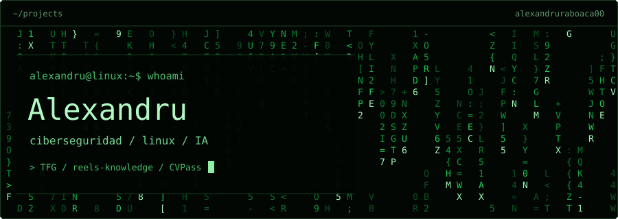

<picture>
  <source media="(prefers-reduced-motion: reduce)" srcset="assets/header-static.svg">
  
</picture>

## Buenas, soy Alexandru

Me gustan la **ciberseguridad**, Linux y hacer herramientas que me resulten útiles. Aquí voy subiendo mi TFG, proyectos personales y cosas que pruebo por mi cuenta.

En algunos proyectos también programo con ayuda de **IA**. La uso para escribir parte del código, probar ideas y resolver problemas.

### TFG · Agentes de IA en CyberBattleSim

Mi Trabajo de Fin de Grado trata sobre agentes de IA en simulaciones de ciberseguridad: cómo toman decisiones y cómo comparar su comportamiento dentro de CyberBattleSim.

Está en una fase inicial de análisis del entorno y pruebas con los agentes de referencia. La integración de agentes basados en modelos de lenguaje es una de las siguientes líneas del trabajo.

[**Ver el TFG →**](https://github.com/alexandruraboaca00/TFG-Agentes-IA-CyberBattleSim)

Empezó en mi otra cuenta, Alrx666. Ahora también está en esta, con el historial original.

### reels-knowledge

Una herramienta para convertir vídeos y reels en notas para **Obsidian**. Usa la transcripción y los fotogramas del vídeo para generar Markdown con enlaces e índices; el procesamiento con los modelos se hace en el equipo.

Me gusta especialmente cómo pasa de un vídeo a una nota que puedo consultar después.

Python · Faster-Whisper · Ollama · FFmpeg · SQLite

[**Ver reels-knowledge →**](https://github.com/alexandruraboaca00/reels-knowledge)

### Otros proyectos

- [**CVPass**](https://github.com/alexandruraboaca00/cvpass): editor de currículums para Linux, con datos en local y exportación a PDF.
- [**FBI Theme**](https://github.com/alexandruraboaca00/FBI_theme_Login_GUI): mi tema para SDDM, con estética de terminal, mapa animado y efecto CRT.

### Tecnologías que aparecen por aquí

`Python` · `TypeScript` · `React` · `Electron` · `SQLite` · `Qt / QML` · `Linux` · `Git`

[Todos mis repositorios](https://github.com/alexandruraboaca00?tab=repositories)
